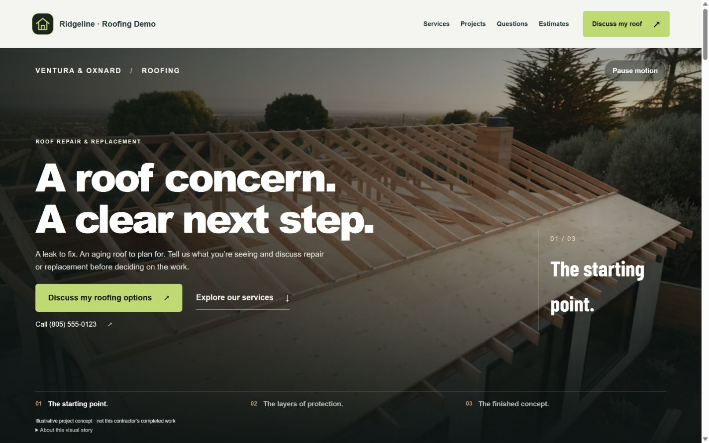
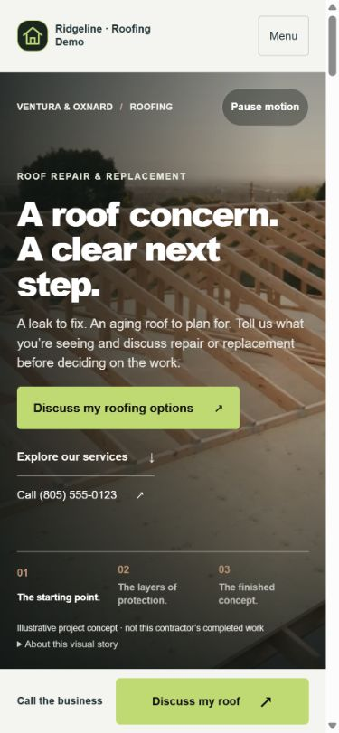
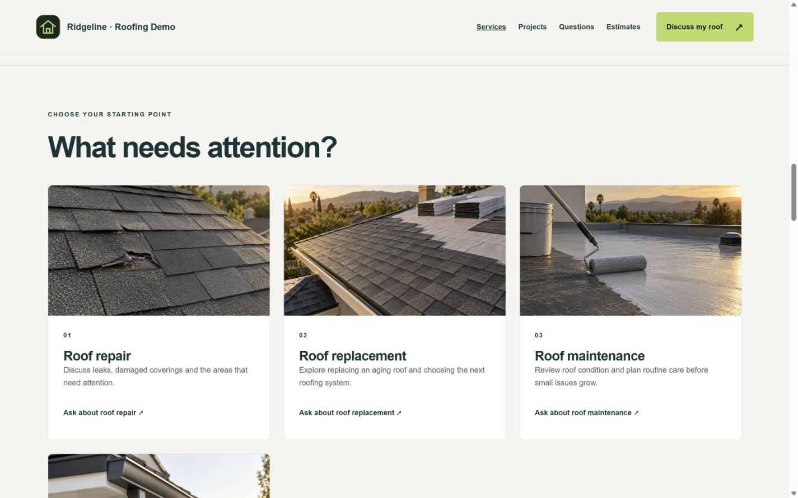
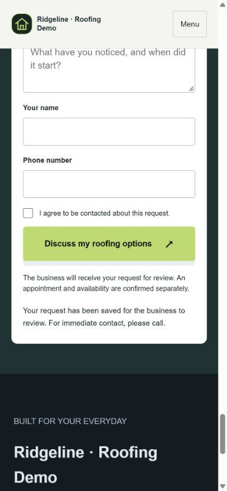

# Ticket #002 — Roofing homeowner journey

Verified 2026-09-24 in the local Website Design working tree. No staging/production deployment or separate CRM change.

## Result

The Roofing reference now uses repair/replacement copy and “Discuss my roofing options” when both services are actually selected. Repair-only contractors retain repair-specific copy. The existing hero headline, Higgsfield scroll film, pause/static fallback, sticky header and selected-service grid are preserved. The fixture selects four services for this check; this does not impose a four-service limit.

F/G remain Partial: this ticket locks the homeowner journey, not the future burst library, randomized pricing placement or distinct mid-page story in later tickets.

## Executed checks

- Fresh esbuild server bundle from `src/worker.js`: exit 0.
- `node tests/conversion-references.mjs`: exit 0. Includes the new fixture, repair and replacement inquiry persistence, repair-only/static fallback and published-snapshot isolation; existing three-journey regression coverage also passed.
- `node tests/scroll-video-controller.mjs`: 8 tests passed, 0 failed. Includes pause, reverse/end-of-film handling, reduced motion and media failure.
- `node node_modules/typescript/bin/tsc -p tsconfig.auth.json`: exit 0. Used the installed compiler directly because npm was not on this shell’s PATH.

```text
PASS Roofing #002: repair/replacement copy matches selected services, direct call/inquiry paths, both inquiry intents persisted, one preserved hero film, repair-only/static fallback and published isolation. Local fixture only.
```

## Browser evidence

Fixture: `http://127.0.0.1:8096/s/roofing-ticket-two`, started with `node scripts/preview-roofing-journey.mjs`. Loopback only, in-memory DB/bucket, synthetic business/contact data and no provider credentials. Restarting the process resets the fixture; Ctrl+C stops it.

- Desktop 1440 × 900 and mobile 390 × 844: no horizontal overflow; direct inquiry and call actions visible in the first screen.
- Desktop header top remained 0 when scrolling down and back up. Services anchor landed below the header (services top ~118px, header bottom ~98px).
- Original film advanced from 0 to 12.040667 seconds of its 12.041667-second duration; upward scrolling returned it to 7.450919 seconds.
- Mobile menu opened and closed after selecting Services; header remained at top 0 and target stayed below it.
- “Ask about roof replacement” selected Roof replacement in the form on desktop and mobile.
- A mobile submission with fictional name/phone, Ventura and Planning ahead returned: “Your request has been saved for the business to review. For immediate contact, please call.” This stored a local request; no external message or remote CRM delivery occurred.
- Mobile action dock hid beside the contact form. No captured browser errors or broken loaded images.
- Temporary viewport override was reset after verification.

## Screenshots









## Reproduction and commit boundary

The three ticket-listed source/test files (`src/conversion-page.js`, `src/platform/conversion.ts`, `tests/conversion-references.mjs`) were previously untracked. This ticket records them with the existing reference scaffolding intact plus the scoped Roofing changes. Other trade copy was not changed. The rest of the pre-existing dirty tree is deliberately not included; these checks describe the current local app, not a clean-checkout release certification.

Commit locator: `fix: lock Roofing homeowner journey (#002)`. No work on #003 was started.
