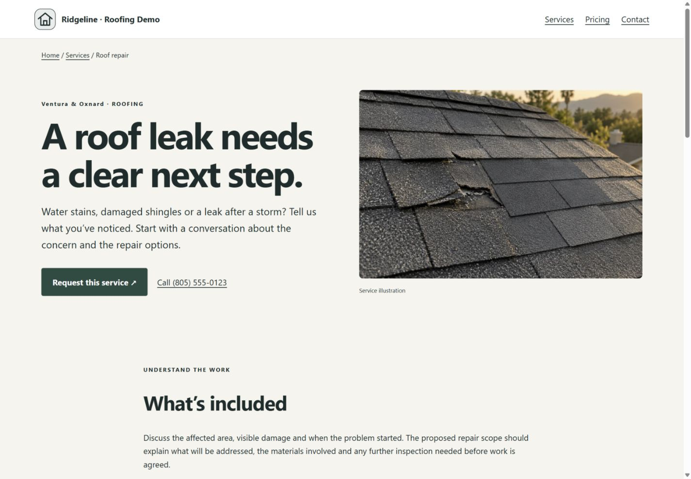
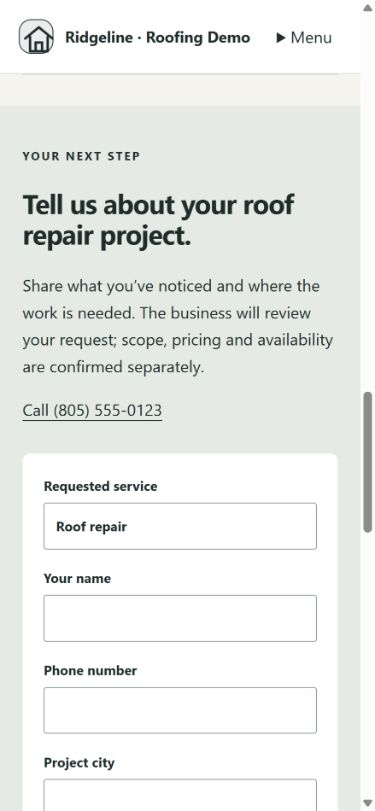

# Ticket #004 — executed local evidence (2026-09-24)

Service route: /s/:slug/services/:service-slug. Local fixture: service-detail-test/services/roof-repair.

Fresh esbuild server bundle: exit 0.
```text
node tests/website-pages.mjs
✔ #004 service detail: published snapshot, preview membership, media and inquiry
✔ #004 shared browser handler preserves service context and suppresses preview sends
ℹ tests 13
ℹ pass 13
ℹ fail 0

node tests/reference-proof.mjs
PASS reference proof: published project map, unpublished isolation, owner visibility, logo privacy/publish, connected review placement, no-key fallback and mocked provider attribution/filtering.

node tests/conversion-references.mjs
PASS conversion references: 3 journeys × 3 layouts, draft isolation, claim approval/escaping, inquiry persistence, preview auth, anchor integrity, one H1, effects, and legacy CTA corrections.
PASS service checklist: custom names, descriptions, deduplication, selection limits, full service rendering and draft isolation.
PASS Roofing #002: repair/replacement copy matches selected services, direct call/inquiry paths, both inquiry intents persisted, one preserved hero film, repair-only/static fallback and published isolation. Local fixture only.

node tests/constitution.mjs
PASS configuration safety, locked values and calculator math
PASS tenant roles, draft/publication isolation, shared footers, feature gates and promotion unlock/expiry
PASS 84 trade/layout legal-preview links and their access controls
```

All final commands exited 0. Tests cover escaped headline/scope/art/process/materials/FAQ, conditional FAQ dependencies, enabled/selected gating, anonymous/outsider/member preview access, immutable public snapshots, published versus draft/thumbnail media, consent/origin rejection, persisted contextual inquiry and the real browser handler's service/city/timing serialization and preview suppression. The original #004 pass used executed tests. Desktop/mobile browser captures were added in the follow-up below.

Earlier test runs exposed outdated #003 expectations (page media now becomes public upon publish), a fixture-generated slug different from the requested URL, and the test VM's CommonJS export binding. These test issues were corrected before the final pass.

The original #004 commit excluded pre-existing foundations/assets. This limitation was resolved by the separately committed and clean-checkout-tested baseline below. Existing provider regression responses are mocks. No external credentials, live integration, deployment or send. Section H stays Partial: #005 links the selected-service grid; further editors, page-family features and generated creative work remain open. #027A Roofing polish remains queued before #028.

## Baseline foundations and screenshots — 2026-09-24

- Baseline commit: **218229b22864c21eacee91b912e6e7654185a57d** — `baseline foundations`. Runtime/client/auth/build foundations, migrations, 14-trade assets and their tests are now committed. No push. Unrelated planning/audit documents remain outside this commit.
- A fresh local clone checked out that exact commit, ran `npm ci --no-audit --no-fund` from package-lock.json, built from source and passed **all 34 executable tests** in `tests/*.mjs` (the import-only preview-fixture.mjs is not a separate test), plus build and TypeScript: **36 commands, 36 passed**. `git status --porcelain` was empty afterward. No source, asset or dist files were borrowed from the dirty checkout.
- Environment: Windows, Node 24.19.0; installed ffprobe added to PATH for the existing scroll-media test. ffprobe is a required external test tool, not an app dependency. The optional ignored DB-IP database was absent in the clean clone; no-data/fake-reader coverage ran. No credentials, production accounts, external delivery or deployment.
- Repairs needed for the baseline check: update the stale demo seed assertion from 7 to 14 trades; locate installed ffprobe. No application behavior was changed for these checks.
- Full outputs: [command results](baseline-tests/results.json), [build](baseline-tests/build.log), [typecheck](baseline-tests/typecheck.log), [page tests](baseline-tests/website-pages.mjs.log), [film decode](baseline-tests/scroll-media.mjs.log). Other test logs are alongside them.

To reproduce after installing locked dependencies, with Node and ffprobe on PATH:

```powershell
node build.mjs
node node_modules/typescript/bin/tsc -p tsconfig.auth.json
Get-ChildItem tests/*.mjs | Where-Object Name -ne preview-fixture.mjs | ForEach-Object { node $_.FullName; if ($LASTEXITCODE -ne 0) { throw "Test failed: $($_.Name)" } }
node scripts/preview-roofing-service.mjs
```

Screenshots use the real public service route at `http://127.0.0.1:8097/s/roofing-service-demo/services/roof-repair` with the committed renderer and a disposable in-memory fictional contractor fixture. The fixture script is retained for reproduction. These show existing service art, not newly generated artwork or a real contractor endorsement.

- Desktop: **1440 × 1000 CSS viewport**.
- Mobile: **390 × 844 CSS viewport**.
- Browser checks: service image loaded, no horizontal overflow on either size; mobile primary CTA scrolls to the contextual inquiry, Roof repair is preselected, sticky header remains visible. No inquiry was sent in this screenshot session.
- Captures are viewport screenshots; full-page stitching was discarded because the browser capture produced duplicated regions. No screenshot retouching.

### Desktop



### Mobile


### Mobile inquiry destination



Ticket #005 has not started.
