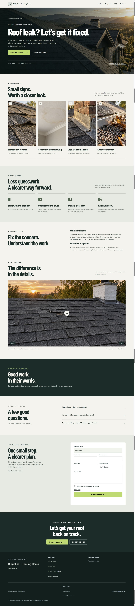
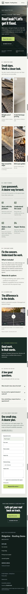

# #004B — Premium design standard

Completed locally on 2026-09-24. No push or deployment. #005 was not started; #027A remains queued before #028.

## Screenshots

Fictional Ridgeline Roofing Demo at /s/roofing-service-demo/services/roof-repair, served with node scripts/preview-roofing-service.mjs. Desktop viewport 1440×1000; mobile 390×844. Browser screenshot output is scaled to 1425 and 375 pixels wide. Full-page PNGs preserve that native capture scale.

The in-app browser's fullPage capture duplicated sections. These full-page images were assembled from overlapping, unmodified viewport captures at observed scroll offsets, cropping the repeated sticky header from subsequent captures. No generated reconstruction or visual retouching. The assembly source is recorded here; temporary capture paths are local to this task. Both final images were visually inspected for continuity from hero to footer.

## Acceptance evidence

- Generated cinematic hero, gradient, bold editable headline, primary/call buttons; no Service illustration caption.
- Four generated warning cards; four-step timeline; keyboard-accessible before/after slider with matched generated images and explicit example label.
- Confirmed profile trust strip with empty-field suppression, rating-source validation, existing license/insurance visibility; confirmed-source reviews, native FAQ, dark final CTA.
- Shared brand-aware CSS/components, contrast-selected button text, responsive type/spacing and reduced-motion behavior. Backoffice Questionnaire saves draft headline/profile/comparison selections.
- Browser: all seven page images loaded after scrolling; no horizontal overflow at desktop/mobile; range changed 50 → 51 using ArrowRight and restored to 50; mobile menu opened and closed after FAQ navigation; FAQ expanded to its answer and collapsed. Full-page captures show every section.
- Fixture intentionally has no rating, tenure, license, insurance, warranty or customer review claims. The trust strip is absent and reviews show an honest empty state. Populated/empty claim cases and confirmed reviews are covered by tests, not invented for screenshots.

## Executed checks

Build, TypeScript and all 35 executable test files: **37/37 PASS**. See [results](tests/results.json), [premium tests](tests/premium-service.mjs.log) and [service route tests](tests/website-pages.mjs.log). Commands: node build.mjs; node node_modules/typescript/bin/tsc -p tsconfig.auth.json; node tests/<name>.mjs for every test except preview-fixture.mjs. Node v24.19.0; ffprobe on PATH for existing video checks.

Premium coverage includes headline escaping and draft/publish isolation, invalid profile claims/source URLs, empty/unconfirmed trust suppression, contrasting brand foreground, comparison ownership/access, real-source review gating, range behavior and reduced-motion reveal. Existing #004 route/lead/preview and broader regression tests pass. No external messages or live-provider success is claimed.

## Generated media

Built-in image_gen generated the seven committed PNG assets under public/assets/premium-roofing/. Exact prompts and source paths: [image-prompts.json](image-prompts.json). The after image is an edit of the before image to preserve perspective; the final gutter image removes an unintended warning placard. These are illustrative assets, not contractor photographs.

## Remaining scope

Shared standard: [TRADE_DESIGN_SYSTEM.md](../../TRADE_DESIGN_SYSTEM.md). Later trade rollouts must supply their own images and copy. Full page creation/editor workflow, homepage Roofing polish #027A, and #005 grid links remain separate. Section H stays Partial.
