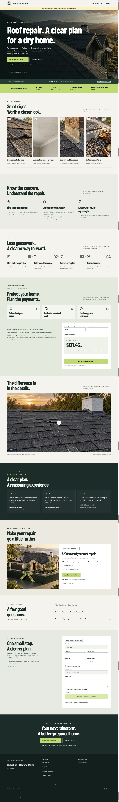

# #004C — Roofing service-page playbook pass

Completed locally on 2026-09-24. #004B remains the design base. Only #004C was implemented; no push, deployment, real lead or lender submission. #005 is next and has not started.

## Section 6 screenshot checklist

Source: [CONVERSION-PLAYBOOK.md, section 6](../../product/CONVERSION-PLAYBOOK.md). Every item below was reviewed against the final desktop/mobile captures and the public/sample behavior checks. The requested sales preview is a clearly labeled exception to the no-fictional-proof rule; public contractor sites still receive only their confirmed data.

| # | Checklist item | Result | Evidence / correction |
|---|---|---|---|
| 1 | Single primary conversion goal obvious within 3 seconds | PASS | Roof repair planning; primary buttons, financing interest and unlocked offers all feed one inquiry. |
| 2 | H1 + qualifying subhead + CTA | PASS | Visible together in desktop and mobile hero. |
| 3 | H1 states offer + benefit | PASS | Revised to “Roof repair. A clear plan for a dry home.” The base headline was less explicit about the offer. |
| 4 | Subhead answers how / who without jargon | PASS | Homeowners in Ventura/Oxnard; discuss cause, repair options and scope before deciding. |
| 5 | Primary button stands out | PASS | Lime brand accent on dark overlay, computed contrasting foreground. |
| 6 | Strong verb + value CTA | PASS | Base FAIL fixed: “Request this service” replaced by “Get my roof repair plan.” No unverified free-inspection promise. |
| 7 | Optional click-trigger under CTA | PASS | Added truthful next-step microcopy; no invented response deadline or free offer. |
| 8 | Profile trust signals, nothing faked | PASS | Real fields retain confirmation/empty suppression; requested sample strip carries SAMPLE labels and a persistent preview notice. |
| 9 | Signs precede deep feature content | PASS | Four generated visual cards precede inclusions/process. |
| 10 | Benefits lead, features support; no inclusion paragraph wall | PASS | Base FAIL fixed with three icon-led benefit cards and short feature bullets. |
| 11 | Dedicated reviews or honest omission | PASS | Base FAIL fixed: no public empty state. Unconfirmed/absent profiles omit the section; zero excerpts/provider failures keep it hidden. Sales mode has exactly three fictional SAMPLE reviews. |
| 12 | Visuals add context; no useless illustration caption | PASS | Generated roof/sign/comparison/promo imagery; no “Service illustration.” Before/after retains the necessary generated-example label. |
| 13 | Background rhythm invites scrolling | PASS | Dark hero, lime trust, warm paper, pale green financing, dark proof, warm offer and dark final CTA. |
| 14 | Final CTA restates value differently | PASS | New angle: “Your next rainstorm. A better-prepared home.” / “Start my dry-home plan.” Same inquiry goal. |
| 15 | Skimmable hierarchy, short blocks and bullets | PASS | Inclusion paragraphs replaced, process icons added, display headings enlarged relative to body. |
| 16 | Emphasis on headlines, CTAs and proof | PASS | Larger 830px desktop hero, 116.64px H1 at 1440px viewport, visual process/inclusions and no public empty review band. |
| 17 | Subtle purposeful motion or intentional stillness | PASS | Reveal, hover and range comparison retained; reduced-motion tests pass. |
| 18 | Mobile CTA/phone usable without pinching | PASS | No horizontal overflow at 390×844; both hero buttons measure 54px high; financing selection checked in mobile inquiry. |
| 19 | No invented public stars/years/license/warranty | PASS | No sample data on public/draft-normal routes; sample route requires tenant access and an unpublished prospect. Publishing makes sample route/unlock unavailable. |
| 20 | No prohibited product/price mentions | PASS | No SiteForge, Launch Window or $750 in service output. |
| 21 | Designed/AI imagery, not contractor photos | PASS | Sales-preview captures use generated hero, signs, comparison and promo. Existing optional owned before/after replacement remains as explicitly requested in #004B; hero/sign/promo assets stay generated. |
| 22 | Positive, specific language | PASS | Service and dry-home goal lead the H1; no negative mood question. |
| 23 | Disciplined attention ratio | PASS | Section anchors in header; one primary inquiry style, secondary phone. Finance and promo CTAs never leave this page. |
| 24 | Consistent agency-grade contrast, space and rhythm | PASS | Final desktop/mobile visual review; shared type, icon, surface and button system throughout. |

**24 PASS / 0 FAIL after revisions.** This is implementation/design acceptance, not a measured conversion-lift claim.

## Full-page screenshots — sales preview

Desktop viewport: 1440×1000. Mobile: 390×844. Final native-scale PNGs: 1425×9529 and 375×12561. The in-app browser's fullPage capture had duplicated sections in #004B, so these use overlapping raw viewport screenshots at verified, stable scroll offsets. Repeated sticky header/sample notice cropped from later slices; no visual reconstruction or retouching. Both assembled pages were inspected from hero through footer. All eight images loaded; no horizontal overflow.

Additional interaction evidence: [sample code unlocked](sample-unlocked.jpg). Main full-page captures show the initial locked state.

## Executed tests and browser checks

- Full build, TypeScript and all 36 executable test files: **38/38 PASS**, [results](tests/results.json). Commands: `node build.mjs`, `node node_modules/typescript/bin/tsc -p tsconfig.auth.json`, and `node tests/<name>.mjs` for all test files except `preview-fixture.mjs`. Node v24.19.0; ffprobe available for the existing film tests.
- After the browser found a missing preview CSRF header, fixed the transport using the existing `/api/session` token. Rebuilt; reran TypeScript, [service-playbook](tests/service-playbook.mjs.log), [website-pages](tests/website-pages.mjs.log) and [premium-service](tests/premium-service.mjs.log), all PASS. The final new regression verifies CSRF and inquiry context; unchanged suite results remain from the full run.
- New tests cover member/anonymous/foreign-tenant access, published/query-string sample isolation, server-only promo code disclosure, wrong answers, origin/preview gates, service tags, expiration, confirmed partner/terms/disclosure prerequisites, zero-APR math, missing-value rejection, source-review empty/failure suppression, and inquiry financing/promotion message context.
- Browser: sample cost changed from $6,000 to $8,000 at the fixed sample 9.99%/60-month terms; payment changed to $169.94/month. Finance CTA selected “I’m interested in financing” without changing Roof repair service or leaving the page. Verified again at mobile width.
- Browser: incorrect sample answer rejected; correct answer revealed SAMPLE-ROOF and populated the same inquiry. Submission remained disabled. Refreshed to initial locked state for full-page captures.
- Public fixture browser review confirmed no sample badge/trust/reviews/financing/promotions and no review empty-state text when nothing is configured. No provider requests or real customer inquiries were submitted by the screenshot fixture.

## How to use

Run `node scripts/preview-roofing-service.mjs` after a build. Sign in on localhost:8097 as the fixture identity `roofing-qa@example.test`, User ID `roofing-qa`. Sales URL: `/sales-preview/roofing-service-prospect/services/roof-repair`. Published comparison: `/s/roofing-service-demo/services/roof-repair`.

In a real backoffice, Questionnaire → Service page headlines & comparison → Open sales preview opens the authenticated unpublished prospect mode. Sample values are renderer-only; they are never saved into settings or copied by publication. Published tenants get 404 on this route. It is not a shareable public prospect link.

Questionnaire → Financing stores the confirmed partner and service example amount/down payment/APR/months. Footer legal stores the required approved disclosure. The service section hides unless all prerequisites exist. APR/term come only from that saved partner scenario; visitors can explore amount/down payment. It is an example estimate, not loan matching/approval, and its CTA only selects financing interest on the inquiry. K05–K07 remain not connected.

Questionnaire → Promotions stores exact service tags and a generated graphic selection alongside the existing real offer dates/terms/quiz/code. Only active tagged offers appear; Roof repair has a generated graphic fallback. One quiz question unlocks through the existing server endpoint; code is absent from initial HTML. Terms still govern redemption. Preview SAMPLE unlock is authenticated, CSRF protected and explicitly non-redeemable.

## Asset provenance and scope

Generated promotion graphic: `public/assets/premium-roofing/promotion.png`, built-in image_gen. [Exact prompt and source](image-prompt.json). Existing #004B generated media is retained. This is a committed manual asset, not an app generation integration.

Shared design standard and owning module docs are updated. The supplied playbook itself is included as this ticket's governing dependency; other previously untracked planning/audit files remain untouched. Section H remains Partial; provider connections, broader page editing, #027A and #005 remain separate.
