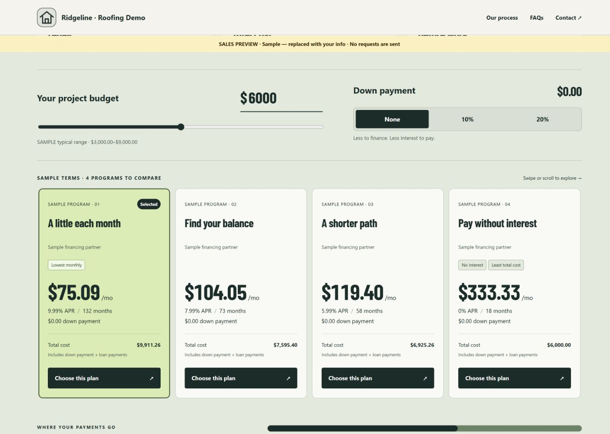
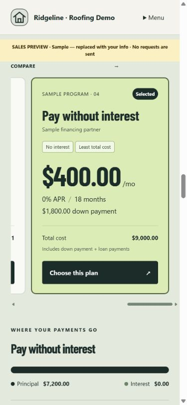

# #004D — Financing calculator redesign

Completed locally on 2026-09-24. #004C was accepted. Scope is #004D only; #004E and additions to #027A were logged without implementation. Nothing pushed or deployed.

## Screenshots

Isolated fictional Roofing fixture at http://127.0.0.1:8097/sales-preview/roofing-service-prospect/services/roof-repair. Sales preview requires local tenant membership, is blocked for a published tenant and cannot submit inquiries. Every shown program is labeled SAMPLE. This is not a lender connection or an offer.

- [Desktop comparison](desktop-comparison.jpg): 1440 × 1000 CSS viewport; default $6,000 from the sample $3,000–$9,000 service range; four cards, None down payment and computed badges.
- [Desktop breakdown and disclosure](desktop-breakdown-disclosure.jpg): principal/interest and required sample disclosure under the cards.
- [Desktop form prefill](desktop-form-prefill.jpg): selected 0%/18-month program, $9,000 project, 20% ($1,800) down and approximately $400/month in the existing inquiry.
- [Mobile selected plan](mobile-selected-plan.jpg): 390 × 844 CSS viewport; selected sample 0%/18-month card, $400/month, $1,800 down, $9,000 total, principal/interest bar. Native swipe between programs verified; no document overflow.

These are focused viewport captures of the changed comparison and inquiry, not new full-page captures. Native screenshot raster dimensions differ from CSS viewport dimensions. The accepted full-page #004C evidence remains in ../004C.




## Acceptance and verification

| Requirement | Result / evidence |
| --- | --- |
| Cost slider + typed input, service default | PASS — saved typical-range midpoint; synchronized input/slider. Missing range waits for entered budget, except migrated saved legacy cost. |
| All configured programs | PASS — every enabled/confirmed program with configured confirmed partner; desktop row, mobile swipe. Up to 24 programs can be saved. |
| Monthly / APR / term / down / total on each card | PASS — direct card markup assertions plus desktop/mobile review. |
| Computed badges | PASS — minimum cent-rounded monthly/total and zero APR; ties receive equal badges. |
| Selected principal / interest bar | PASS — live selected-plan breakdown; zero-APR interest is $0. |
| None / 10% / 20% down | PASS — rounded dollar amount, all programs update; count-up disabled for reduced motion. |
| Same-form prefill | PASS — browser selection plus controller-to-handler-to-real-local-API inquiry persistence test. Invalid cost clears stale estimates; corrected cost restores the chosen program; successful submit clears prefill. |
| Contractor-only terms and hide when empty | PASS — no confirmed programs/partner/disclosure hides; explicit [] clears legacy terms. |
| Deferred interest and disclosures | PASS — each deferred program is labeled with conditional-interest explanation; saved footer disclosure stays under cards. No lender exits. |
| Four sales samples | PASS — exact 9.99%/132, 7.99%/73, 5.99%/58, 0%/18, labeled samples; published/query sample isolation regression passes. |
| Responsive / browser health | PASS — 1440 desktop and 390 mobile, horizontal card swipe with no document overflow; no observed console warnings/errors. |

Full regression: build + TypeScript + all 37 executable test files = **39 commands passed**, recorded in [tests/results.json](tests/results.json). The final affected checks are in [tests/final-checks.log](tests/final-checks.log).

Focused command: `node tests/financing-comparison.mjs`:

```text
PASS #004D payment math: amortization, zero APR, cents rounding, down-payment totals, computed badges/ties and invalid input.
PASS #004D configuration: every confirmed program, legacy migration/explicit clear, missing gates hide, invalid terms/ranges, required card details, deferred-interest labels and four isolated samples.
PASS #004D browser/API: live slider/input/down changes, reduced motion, invalid-input clearing, selected-plan prefill, updated estimates, same inquiry persistence, reset and preview-send suppression.
```

The #004C legacy-term gating test now changes raw configuration before normalization, exercising migration into the authoritative program list. It still checks missing terms/confirmation/disclosure and partner mismatch. A new explicit-empty-list test ensures programs do not reappear through legacy fallback.

## Limits and handoff

Fixed-rate estimates use configured APR/term; totals exclude fees and contingent deferred-interest charges, disclosed below the cards. Choosing a program expresses interest, not approval. No real lender APIs were contacted; K05–K07 remain not connected. Shared standalone Financing page behavior is unchanged. No Lighthouse score or live financing approval is claimed.

Commit locator: `feat: compare configured service financing plans (#004D)`.
Next ticket: **#004E — Not started**. #027A stays queued before #028.
