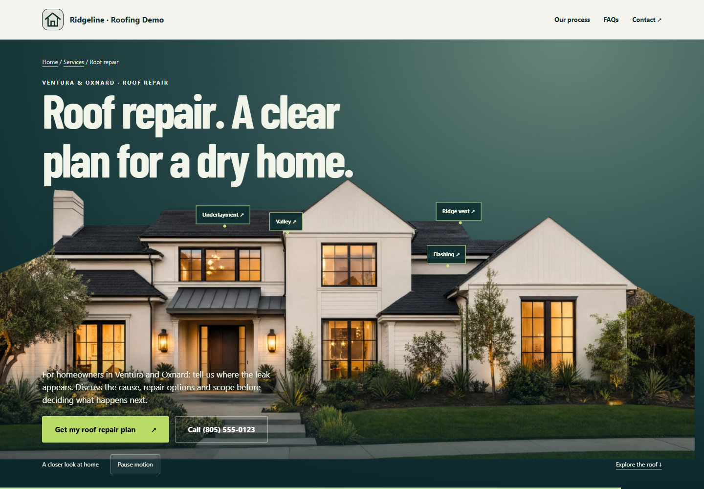
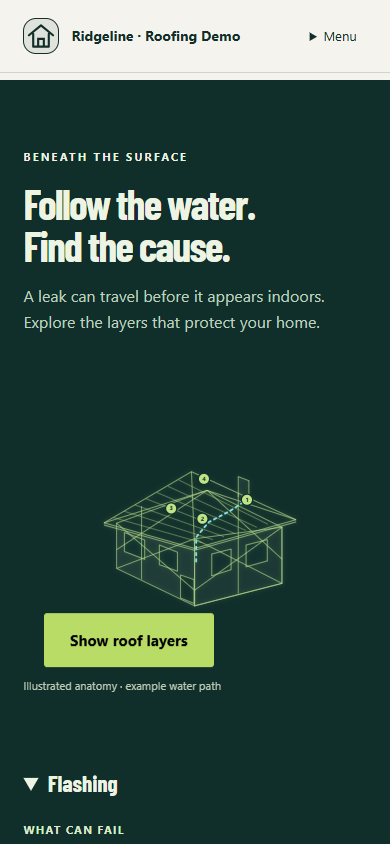

# #004E — Cinematic motion kit (local placeholder mode)

#004D accepted. #004E implemented on 2026-09-24; #027A financing requests queued only. No push or deployment.

## Evidence

- [Desktop — house and tracked callouts](desktop-roof-callouts.png), [opening hero](desktop-hero.png), [X-ray](desktop-xray.png), [full page](desktop-full.png).
- [Mobile — hero](mobile-hero.png), [X-ray](mobile-xray.png), [full page](mobile-full.png).
- [Reduced-motion poster](reduced-motion.png).
- [Scroll screen recording](scroll-effects.webm): actual Chromium viewport frames, 1440×1000, forward and reverse camera, anatomy/X-ray and process. 706 captured frames, encoded to VP9 WebM. Playback decoded and sought to 5 seconds successfully (readyState 4).
- [Browser assertions](browser-results.json) and [build/regression outputs](checks.log).

## Implemented

Shared trade-configured hero camera keyframes, video/image-sequence slots, synchronized foreground-mask slots, parallax headline, scene-space callouts and interpolated production tracking. Hero labels link to the same disclosures as the keyboard/touch anatomy hotspots. Roof layers separate during scrolling; X-ray dissolves to trusses and a flowing example water path. Ductwork and pipe-run SVG renderers/config examples are available for later trade adoption; other trade pages are not enabled.

Four coherent animated warning illustrations play once, process line and steps respond to scroll with phase chips, age/damage inputs drive a clearly educational repair/replace meter, confirmed business years count up, existing source-backed reviews (or clearly labeled private sales samples) move in a pausable marquee, and the final CTA has restrained rain. Existing financing math/layout, inquiries, offers and sample authorization remain intact.

## Media boundary

Supplied Roofing still: docs/build-evidence/assets/roofing/roofing-house-still.png, 3840×2160. It is used through a 1920×1080 WebP derivative (296,096 bytes). Both requested MP4s were absent. The camera uses the supplied still and a temporary SVG polygon foreground mask, with lightweight cloud/neighborhood layers. This demonstrates the five camera beats; it is not a rendered FPV drone flight. Mobile uses a light 5-second transform loop until its short clip is supplied. Reduced motion shows only the poster and removes video requests. Real footage labels remain hidden until tracking is supplied; masks and tracking require synchronized production assets. See [NEEDS-ASSETS](../../../NEEDS-ASSETS.md) for all 14 trades, exact filenames, durations, dimensions and frame counts.

The source PNG remains in the user's incoming asset directory. The public WebP needed for this implementation is committed. No paid asset generation or external integration was performed. K02 is not required for placeholder mode.

## Verification and limits

All eight commands passed: build, TypeScript, premium service, service playbook, financing comparison, website pages (13 tests), conversion references and scroll story. Browser assertions passed at desktop 1440×1000 and mobile 390×844: reverse/forward camera; four hero anchors; linked disclosure; X-ray; meter extremes; pause/resume; dynamic reduced-motion preference; mobile loop; no horizontal overflow; keyboard disclosure; failed-video fallback; video seeking/unloading; frame-sequence selection; sample-markup marquee pause; no observed page errors. Video and image-sequence tests temporarily substitute existing local assets through browser request interception; they do not change production configuration or claim these are the requested drone renders. Server sample isolation is independently covered by service-playbook.mjs.

Capture uses the disposable scripts/preview-roofing-service.mjs fixture at 127.0.0.1:8097. Browser reproduction: provide PLAYWRIGHT_MODULE if Playwright is outside normal module resolution, CHROME_PATH if using installed Chrome, and optionally EVIDENCE_DIR/PREVIEW_URL; run node docs/build-evidence/004E/browser-qa.cjs. No customer messages or real provider requests.

Motion uses transform/opacity, one coalesced requestAnimationFrame per scroll update, fixed stage dimensions, an optimized poster and deferred below-fold image loading. Lighthouse and physical-device 60fps certification were not run; these screenshots and local browser checks do not establish either. Production films still need performance/visual review when supplied. Broad pack sections remain Partial.

Commit locator: feat: add trade cinematic motion kit (#004E). Next ticket #005; not started. Stop.
