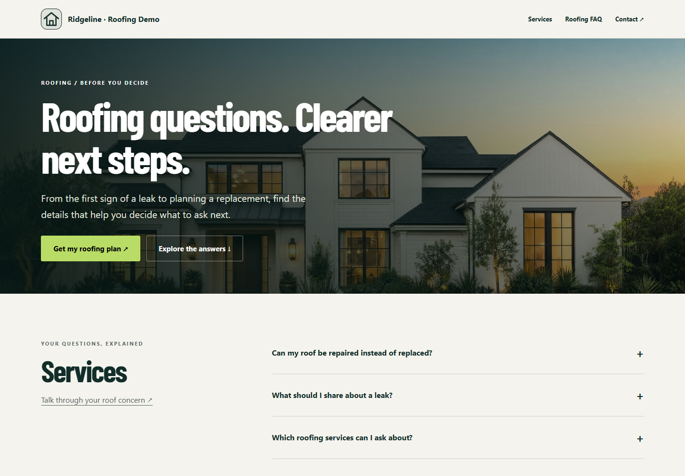
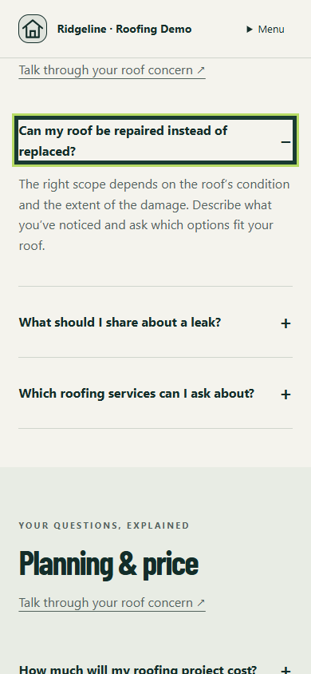

# #006 — Published Roofing FAQ route

Completed locally on 2026-09-24. Enabled saved Roofing FAQ records render at /s/:slug/faq with grouped native disclosures, matching FAQPage structured data, shared premium typography and generated imagery. Both homepage renderers, service pages and the shared footer link to the enabled FAQ. Optional financing and promotion questions/links follow feature flags. Contact actions lead to the existing homepage inquiry; no request is sent by these checks.

## Screenshots

Chrome, desktop 1440×1000 and mobile 390×844. Full-page captures show all six groups and 16 fixture questions; answer captures show a keyboard-opened disclosure. Images were visually reviewed for readability, spacing and overflow.

| View | Desktop | Mobile |
|---|---|---|
| Entire FAQ | [Full page](desktop.png) | [Full page](mobile.png) |
| Hero | [Hero](desktop-hero.png) | [Hero](mobile-hero.png) |
| Expanded answer | [Answer](desktop-answer.png) | [Answer](mobile-answer.png) |




## Executed verification

| Command | Result | Output |
|---|---|---|
| node build.mjs | Exit 0; 276 referenced assets, 14 kits | [Build](build.txt) |
| node node_modules/typescript/bin/tsc -p tsconfig.auth.json | Exit 0 | [TypeScript](typecheck.txt) |
| node --test tests/website-pages.mjs tests/conversion-references.mjs tests/premium-service.mjs tests/constitution.mjs | 18 reported tests pass, zero failures | [Tests](tests.txt) |
| node scripts/capture-roofing-faq.cjs | Desktop and mobile pass | [Browser](browser-final.txt) |


Actual final test summary:


```text
tests 18
pass 18
fail 0
PASS desktop 1440x1000: 16 answers, matching schema, keyboard disclosures, navigation from both homepages, service/contact links, mobile menu, reduced motion, no overflow or page errors
PASS mobile 390x844: 16 answers, matching schema, keyboard disclosures, navigation from both homepages, service/contact links, mobile menu, reduced motion, no overflow or page errors
```

The new regression exercises unpublished/disabled/private preview boundaries, outsider denial, public snapshot isolation during draft edits, publication, both independent feature switches, hidden empty groups, empty FAQ fallback, non-Roofing rejection, method rejection, related links and HTML/JSON-LD escaping. The published schema uses exactly the visible answer list. Existing service, conversion and constitution suites cover preserved behavior.

The initial test fixture failed existing validation because enabled financing requires a confirmed configured link; the fixture now supplies a fictional example.test link. A non-Roofing fixture also needed a matching journey. The first browser run used an incorrect mobile-menu selector; [its output](browser.txt) is retained. These fixture/harness issues were corrected; final outputs above pass.

## Reproduce

1. Run node build.mjs, then node scripts/preview-roofing-faq.mjs (port 8099; disposable in-memory database/bucket).
2. Open http://127.0.0.1:8099/s/grid-roof-repair/faq or http://127.0.0.1:8099/s/grid-standard/faq.
3. Run node scripts/capture-roofing-faq.cjs with Playwright installed, or set PLAYWRIGHT_MODULE to its package directory and CHROME_PATH to a local Chrome executable.

The 16-question fixture is fictional local data, saved and published through existing APIs. No production/default tenant seeding, dedicated FAQ editor or other-trade rollout is included. Source answers are contractor-authored plain text; the renderer adds no promises or prices. Section L remains Partial. No provider was contacted and no customer message, push or deployment occurred.

Only planning text changed in #027A: all four requested homepage improvements remain queued. Next ticket: #007. Commit locator: feat: add published Roofing FAQ route (#006).
