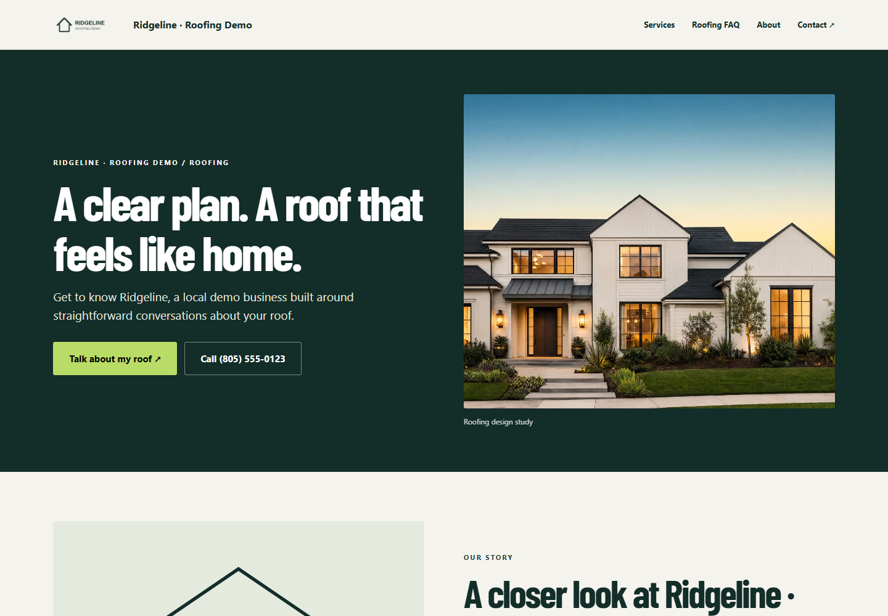
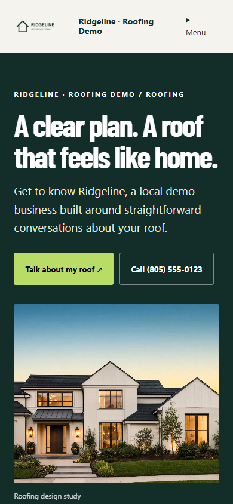

# #007 — Published Roofing About route

Completed locally on 2026-09-24. Enabled saved Roofing About records render at /s/:slug/about. The page uses the shared premium trade CSS/JS, generated Roofing hero, confirmed copy and owned logo/portrait references. It is linked from both homepage renderers, service/FAQ pages and the shared footer. No other numbered ticket was implemented.

## Desktop and mobile screenshots

Chrome at 1440×1000 and 390×844. Full-page images were reviewed for hierarchy, text readability, spacing, loaded images and overflow. The main fixture has no portrait and shows labeled designed brand artwork; the second fixture tests the uploaded-photo slot using a roof photo explicitly labeled as not an employee portrait. No real or generated employee is impersonated in this evidence.

| View | Desktop | Mobile |
|---|---|---|
| Entire About page | [Full page](desktop.png) | [Full page](mobile.png) |
| Hero and logo | [Hero](desktop-hero.png) | [Hero](mobile-hero.png) |
| Confirmed story and designed fallback | [Story](desktop-story.png) | [Story](mobile-story.png) |
| Owned uploaded image slot | [Uploaded image](desktop-uploaded.png) | [Uploaded image](mobile-uploaded.png) |




## Test output

| Command | Result | Output |
|---|---|---|
| node build.mjs | Exit 0; 276 referenced assets, 14 kits | [Build](build.txt) |
| node node_modules/typescript/bin/tsc -p tsconfig.auth.json | Exit 0 | [TypeScript](typecheck.txt) |
| node --test tests/website-pages.mjs tests/conversion-references.mjs tests/premium-service.mjs tests/reference-proof.mjs tests/constitution.mjs | 20 reported tests pass, zero failures | [Full tests](tests.txt) |
| node scripts/capture-roofing-about.cjs | Desktop and mobile pass | [Browser output](browser.txt) |

Actual result:

```text
tests 20
pass 20
fail 0
PASS desktop 1440x1000: confirmed story, three why-us points, uploaded logo and portrait slot, honest no-person fallback, both homepage menus, keyboard skip/menu, service/contact links, reduced motion, loaded images, no overflow or page errors
PASS mobile 390x844: confirmed story, three why-us points, uploaded logo and portrait slot, honest no-person fallback, both homepage menus, keyboard skip/menu, service/contact links, reduced motion, loaded images, no overflow or page errors
```

The #007 regression tests unpublished/disabled/non-Roofing routes, preview authentication and outsider denial, draft/published isolation, method rejection, text escaping, confirmed/unconfirmed copy, related links, logo/portrait rendering, foreign-tenant rejection, draft image privacy, and revocation of portrait access when published mode changes. Existing tests cover publication revalidation, services, FAQ, inquiries, media and review proof.

Custom About copy requires the existing Questionnaire business-facts confirmation. An enabled uploaded portrait becomes public only with the published About snapshot; its sibling photos stay private. AI portrait mode renders a designed fallback and grants no portrait access. No automatic copy/portrait generation or dedicated editor is claimed; section Q remains Partial.

## Reproduce

1. Run node build.mjs and node scripts/preview-roofing-about.mjs (port 8100; in-memory database/bucket).
2. Open http://127.0.0.1:8100/s/about-fallback/about and http://127.0.0.1:8100/s/about-uploaded/about. The standard-homepage fixture is /s/about-standard.
3. Run node scripts/capture-roofing-about.cjs. Install Playwright or set PLAYWRIGHT_MODULE to its package directory; CHROME_PATH can point to local Chrome.

The fictional Ridgeline logo is a simple locally drawn test fixture at tests/fixtures/roofing-demo-logo.jpg; it is uploaded through the existing photo API. All fixture copy is explicitly fictional and saved/published through existing APIs. No external provider or customer was contacted.

## Queued work and commit

The two FAQ answer and eyebrow items were absent from #027A and are now added exactly as supplied by Joe, queue only. This ticket does not rewrite FAQ answers or change FAQ group eyebrows. Dedicated About editor/generation and other trades remain later tickets. No push or deployment.

Commit locator: feat: add published Roofing About route (#007). Next ticket: #008. Stop.
