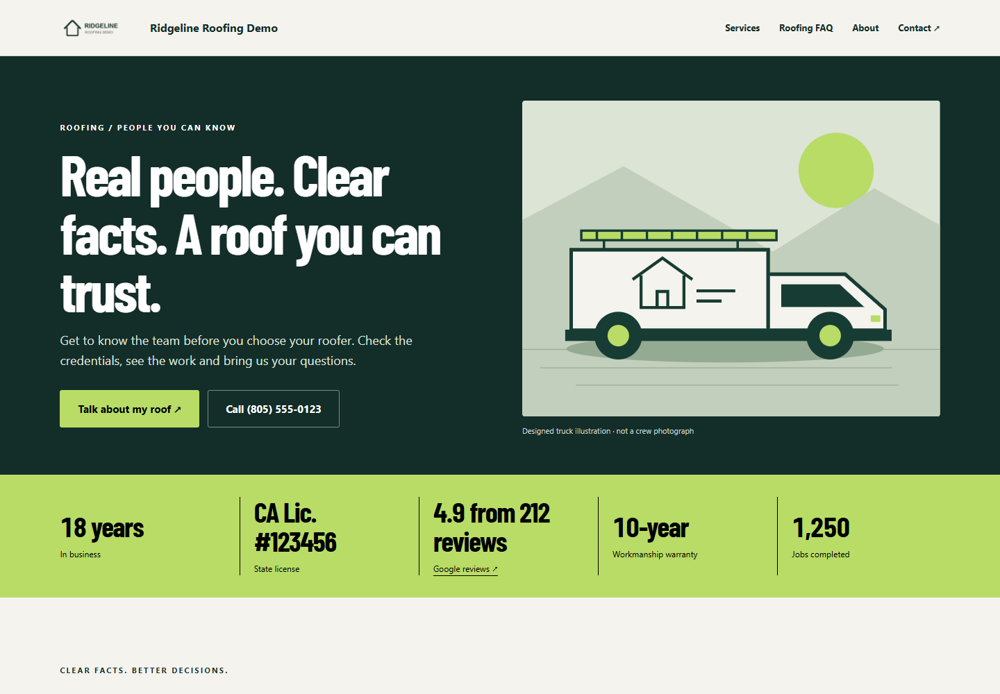
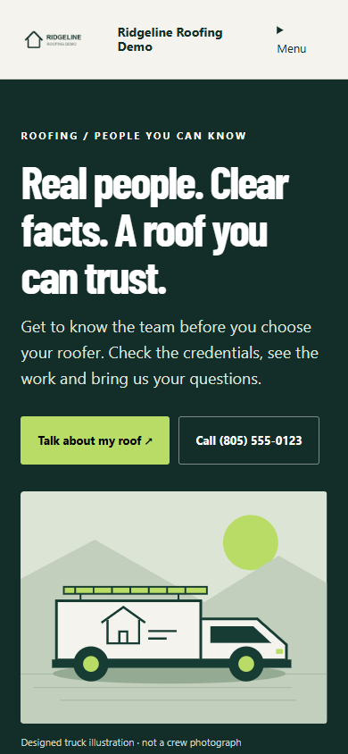

# #007A — Roofing About, redesigned for trust

Completed locally on 2026-09-24. Only #007A was implemented. The new About page leads with people/crew imagery or a designed Roofing truck, then confirmed facts, three visual proof cards, a short story and published work. The footer disclaimer remains queued in #027A.

## Screenshots

Chrome: desktop 1440×1000, mobile 390×844. Visually reviewed for hierarchy, readable content, stat/card layout, image loading and overflow. All names, credentials, ratings, job counts and projects in these screenshots are fictional local QA data. They are not customer claims or connected Google results. No person was generated. The owned-photo branch is tested with a labeled test image; main visual evidence shows the truck fallback.

| View | Desktop | Mobile |
|---|---|---|
| Entire page | [Desktop](desktop.png) | [Mobile](mobile.png) |
| Hero | [Hero](desktop-hero.png) | [Hero](mobile-hero.png) |
| Proof cards | [Cards](desktop-proof.png) | [Cards](mobile-proof.png) |
| Published projects + map chip | [Projects](desktop-projects.png) | [Projects](mobile-projects.png) |
| No confirmed stats / no projects | [Empty-data page](desktop-empty.png) | [Empty-data page](mobile-empty.png) |

[Questionnaire fields and confirmations](questionnaire.png)




## Executed test output

| Command | Result | Output |
|---|---|---|
| node build.mjs | Exit 0; 276 referenced template assets, 14 kits | [Build](build.txt) |
| node node_modules/typescript/bin/tsc -p tsconfig.auth.json | Exit 0 | [TypeScript](typecheck.txt) |
| node --test tests/website-pages.mjs tests/conversion-references.mjs tests/premium-service.mjs tests/reference-proof.mjs tests/constitution.mjs tests/client-modules.mjs | 22 tests pass, zero failures | [Full test output](tests.txt) |
| node scripts/capture-about-trust.cjs | Desktop, mobile and Questionnaire saves pass | [Browser output](browser.txt) |

Actual final summary:

```text
tests 22
pass 22
fail 0
PASS desktop: 5 confirmed stats, final count-up and reduced-motion values, 3 proof cards, <=60 story words, <=2 name mentions, 3 published project links, map chip, no-data omission, owned hero, mobile menu, no overflow/page errors
PASS mobile: 5 confirmed stats, final count-up and reduced-motion values, 3 proof cards, <=60 story words, <=2 name mentions, 3 published project links, map chip, no-data omission, owned hero, mobile menu, no overflow/page errors
PASS real Questionnaire mount + API saves: edited values clear individual confirmation, draft save preserves published facts, explicit reconfirmation persists, insurance No clears confirmation.
```

API tests cover optional-field validation, incomplete confirmations, missing/one/five facts, draft/published separation, older-editor preservation, confirmed insurance No, <=60 story words, 3–5-word card headings, owned-photo privacy, approved project snapshots, draft project edits and unpublishing. Existing access/media/FAQ/service regression coverage still passes. The UI harness mounts the actual Questionnaire module and saves through a local authenticated session with CSRF protection.

The browser test caught and fixed a redundant third company-name mention and an object merge-order bug that overwrote edited trust fields. The initial HTTP save harness used obsolete identity headers; it now uses the existing session/CSRF flow. A project fixture initially lacked required approximate coordinates; it now supplies them. Final results above reflect the corrected code and fixtures.

## Behavior and limits

- Every trust group is optional and independently confirmed. A missing fact is hidden. Google requires a rating, review count and HTTPS Google source before confirmation; values are manually entered, not live-synced or independently verified.
- The band shows up to five facts; if only one or two are confirmed, those render without invented fillers. At zero, the band disappears. License identifiers remain static; numeric facts animate visually while their final accessible values remain available. No-JS/reduced-motion displays final values.
- The three cards use confirmed proof where supplied. Missing proof is replaced by neutral homeowner next-step guidance, never an invented business claim.
- Existing owned About portrait takes priority, then a visible owned owner/crew photo; otherwise a labeled truck illustration. No house hero or generated employee. An owned-photo fixture uses a roof image only to test the media path and is not presented as an employee in the visual evidence.
- The displayed story is capped at 60 words without overwriting stored owner copy. Header and copyright retain the company name; repeated editorial mentions and redundant footer heading are removed from this About view.
- Up to three approved published project snapshots reuse their own published gallery/comparison photos. No qualifying projects hides the whole work section. The map chip uses the supplied service area and links to the existing Project Map; no office locations are invented.
- #027A already contained the disclaimer-removal item. It now explicitly covers site-wide removal and Joe's wording variant. The footer disclaimer, FAQ answer rewrites and FAQ eyebrow changes are not implemented here.

## Reproduce

1. Run node build.mjs, then node scripts/preview-about-trust.mjs (port 8101; disposable in-memory database/bucket).
2. Open http://127.0.0.1:8101/s/trust-full/about and /s/trust-empty/about. The /s/trust-uploaded/about fixture exercises the existing owned-photo path.
3. Run node scripts/capture-about-trust.cjs with Playwright installed, or PLAYWRIGHT_MODULE pointing to its package directory and CHROME_PATH to Chrome. Start a fresh preview process before each capture run because the Questionnaire test changes the fixture draft. The preview writes local-fixture.json solely for this test.

No provider calls, image-generation spend, customer messages, push or deployment. Broader trust selection/generation and other trades remain future work; section Q remains Partial. Commit locator: feat: redesign Roofing About around confirmed trust (#007A). Next ticket: #008. Stop.
