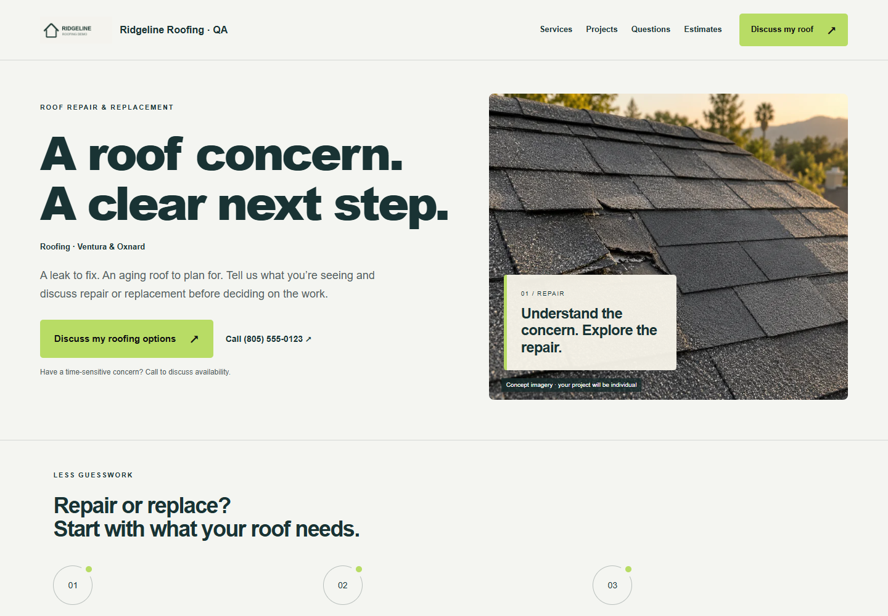

# #008 — Trust selections and evidence

Completed locally, 2026-09-24. Settings now store 16 supported network types, explicit selections, profile approval, display preference, source evidence, check/expiry dates and optional ratings or credentials. Missing data never creates a claim. This ticket adds the contract; the strip renderer is #009 and backoffice controls remain #047.

## Desktop and mobile evidence

Chrome 1440×1000 and 390×844; fictional Ridgeline QA business. These fresh screenshots verify that saving the new contract does not change the existing homeowner page. The uploaded logo loads; no private draft evidence, overflow or page errors. The #027A caption/header changes are still queued.

## Executed tests

| Check | Result | Output |
|---|---|---|
| node build.mjs | PASS, 276 assets / 14 kits | [Build](build.txt) |
| node node_modules/typescript/bin/tsc -p tsconfig.auth.json | Exit 0 | [Typecheck](typecheck.txt) |
| node --test tests/trust.mjs tests/constitution.mjs tests/reference-proof.mjs | 5 passed, 0 failed | [Tests](tests.txt) |
| node scripts/capture-trust-model.cjs | Desktop/mobile pass | [Browser](browser.txt) |

Coverage includes bounded values, unique networks/placements, network-domain HTTPS checks, invalid dates/ratings, omission preservation, explicit clear, approval, incomplete/expired/future evidence, license support, real API draft/snapshot separation, auth/origin checks and rechecking forged drafts at publication. Public selection filters re-evaluate expiration at render time. Existing constitution and project/logo/review regressions pass.

## Boundaries

- A rating/credential cannot be published when selected without approved profile, confirmed source URL, valid check date and unexpired evidence. State-license claims also need individually confirmed license number/state.
- These are manually supplied, owner-confirmed facts. They are not independent membership verification or live review feeds. Plain approved profile links need no invented rating.
- Evidence notes are private settings data, never rendered by the public projection. Raw HTTPS links are never fetched by this model. Source URLs for known networks must match their domains.
- Disabled strips retain draft selections. Older editors preserve omitted trust settings; an explicit empty object clears them. No legacy trust fields are silently upgraded into these confirmations.
- No new keys or marks are needed. No provider calls, paid generation, sends, push or deployment.

Reproduce: build, start node scripts/preview-trust-sites.mjs (disposable port 8102), then run scripts/capture-trust-model.cjs with PLAYWRIGHT_MODULE/CHROME_PATH for the local browser. Commit locator: feat: model trust selections and evidence (#008). Next #009.
