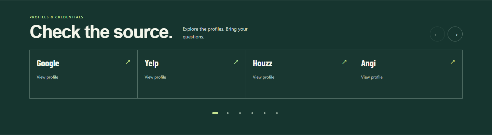
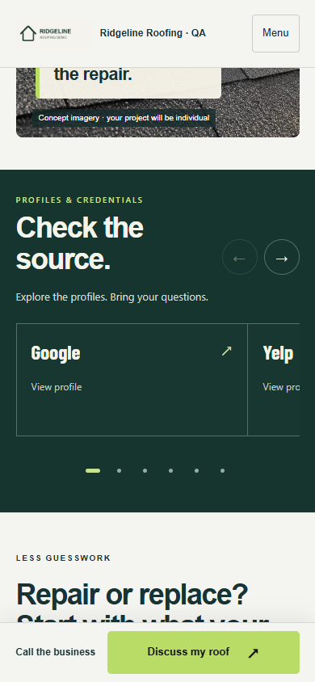

# #009 — Roofing trust strip

Completed locally, 2026-09-24. Approved selected profiles now render in a dark green proof band: up to five use a static row, larger sets use a native swipe carousel with arrows and profile dots. Text names replace network marks until permitted assets are supplied. The existing inquiry CTA and hero remain intact.

## Desktop and mobile evidence

| State | Desktop | Mobile |
|---|---|---|
| Six selected profiles | [Context](desktop.png) | [Context](mobile.png) |
| Three-profile row | [Row](desktop-row.png) | [Row](mobile-row.png) |
| Empty selection | [Omitted](desktop-empty.png) | [Omitted](mobile-empty.png) |

Chrome 1440×1000 / 390×844. All business/profile/credential data is fictional local QA. The BBB membership in this fixture is synthetic evidence for rendering, not a real affiliation. No provider links were visited. Names are plain typography, not licensed network marks. Only the new strip is reviewed here; queued #027A caption/header changes remain unchanged.

## Executed output

| Command | Result | Evidence |
|---|---|---|
| node build.mjs | PASS, 276 assets / 14 kits | [Build](build.txt) |
| node node_modules/typescript/bin/tsc -p tsconfig.auth.json | Exit 0 | [Types](typecheck.txt) |
| node --test tests/trust.mjs tests/conversion-references.mjs tests/reference-proof.mjs tests/premium-service.mjs tests/website-pages.mjs | 26 passed, zero failed | [Tests](tests.txt) |
| node scripts/capture-trust-strip.cjs | Desktop/mobile/no-JS pass | [Browser](browser.txt) |

The browser exercises both arrows, return from the final card, Home/End keys, profile dots, reduced motion, native scrolling without JavaScript, source links, private draft omission, and zero overflow/page errors/external calls. API tests cover source/expiry/approval gates, escaping, omission of marks and invented ratings, public versus private preview, snapshot-preserving draft edits and all selected placement hooks. Both Roofing homepage renderers support below-hero, above-reviews, services, forms and footer placements; the service page supports service-hero.

## Provider and asset boundaries

The strip is a source-link component. It does not fetch excerpts or claim a connected feed. Optional numeric ratings require the #008 evidence gates and display the owner-confirmed check date. Credentials never receive stars. Hidden, unapproved, expired or empty selections render no chrome. No selected network is randomized or inferred from existing review settings.

K03/K04 live Google/Yelp feeds remain unverified; the existing review section continues to provide attributed feed results or source-link fallback independently. K22 logo permissions/assets are missing: text is the delivered fallback. NEEDS-KEYS.md and NEEDS-ASSETS.md record this. Dedicated controls remain #047; other-trade adoption and optional Financing/Promotions proof placement remain future work. Section P stays Partial.

Reproduce: build; node scripts/preview-trust-sites.mjs; node scripts/capture-trust-strip.cjs with PLAYWRIGHT_MODULE/CHROME_PATH. Local in-memory fixtures only. No paid generation, messages, push or deployment. Commit locator: feat: render selected Roofing trust profiles (#009). Next #010.
