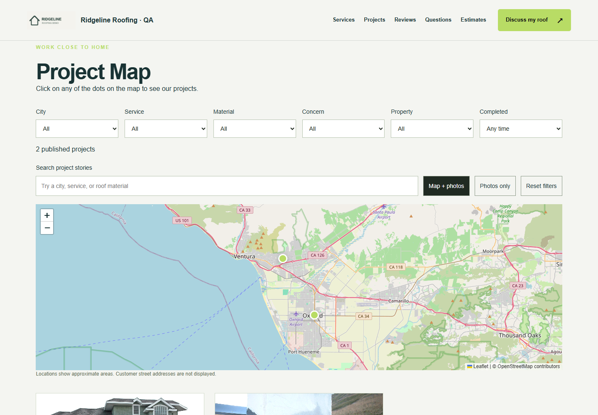
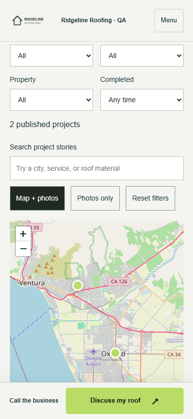

# #010 — Roofing map, logo and review placement

Completed locally, 2026-09-24. Verified the actual approved-project publication flow, uploaded branding, Google/Yelp attribution and useful empty states on desktop and mobile. Fixed the project-story return link for kit homepages (#projects instead of the legacy #area anchor). Shortened the Roofing-only empty-map copy and retained its direct project-request action.

## Evidence and fixture truth

These are **real persisted records created and approved through the app’s APIs**, using **fictional QA project content and existing test photos**, not real customer work. The logo is the existing Ridgeline QA fixture. No owner-supplied completed-project pack or real business logo was supplied for this session; NEEDS-ASSETS records that gap. No renderer-only demonstration projects are enabled. Two records are published; draft edits, a third private project and later-uploaded photos remain private.

**Google/Yelp responses are mocked.** Names and review text visibly say QA/fictional. Google returns its original 3.8 / 40 aggregate even though the featured excerpt is 5-star; the filtered 2-star excerpt is excluded without recalculating that aggregate. The fallback fixture has no provider keys. No live review/account validation is claimed. OpenStreetMap tiles loaded normally in the browser and retain attribution; the missing-map test deliberately blocks Leaflet.

Chrome: desktop 1440×1000, mobile 390×844. Reduced motion provides stable captures of the existing hero. Captures are unretouched browser screenshots.

| View | Desktop | Mobile |
|---|---|---|
| Uploaded logo + preserved hero | [Hero](desktop-hero.png) | [Hero](mobile-hero.png) |
| Project Map + filters | [Map](desktop-map.png) | [Controls](mobile-map.png) / [Pins](mobile-map-close.png) |
| Published project photos | [Projects](desktop-projects.png) | [Projects](mobile-projects.png) |
| Project popup/comparison | [Popup](desktop-popup.png) | [Popup](mobile-popup.png) |
| Review placement | [Reviews](desktop-reviews.png) | [Reviews](mobile-reviews.png) |
| Mock Google source and aggregate | [Google](desktop-google.png) | [Google](mobile-google.png) |
| Mock Yelp attribution | [Yelp](desktop-yelp.png) | [Yelp](mobile-yelp.png) |
| No connected feed, source links only | [Source links](desktop-source-links.png) | [Source links](mobile-source-links.png) |
| No projects/logo/reviews | [Empty](desktop-empty.png) | [Empty](mobile-empty.png) |

[Missing map library fallback](mobile-map-unavailable.png). Existing queued #027A captions and duplicate logo-name text remain unchanged.

## Executed tests

| Command | Result | Output |
|---|---|---|
| node build.mjs | PASS, 276 assets / 14 kits | [Build](build.txt) |
| node node_modules/typescript/bin/tsc -p tsconfig.auth.json | Exit 0 | [Types](typecheck.txt) |
| node --test tests/reference-proof.mjs tests/trust.mjs tests/conversion-references.mjs tests/project-experience.mjs | 9 passed / 0 failed | [Tests](tests.txt) |
| node scripts/capture-reference-proof.cjs | Desktop/mobile, map failure and no-JS pass | [Browser](browser.txt) |

Browser coverage: two published/approved records, correct city coordinates and loaded photos/logo; city/search/reset filters; map/list switches; popup comparison; project story → actual homepage map; Google/Yelp source links, author/excerpt labels and original aggregate; no-feed fallback; missing-logo mark; concise empty map → inquiry; no horizontal overflow or page errors. No inquiry was submitted.

Privacy coverage: unpublished jobs and draft edits stay out of public markup; late photos on published projects remain inaccessible; draft logos/review profiles do not replace public snapshots; cross-tenant logo selection is rejected; project unpublish removes its story/map/media access. API tests receive 401 for private media; real HTTP correctly redirects to login (303, no JPEG bytes). The initial browser assertion followed that redirect to the 200 login page; it was corrected to inspect the redirect itself. No application privacy defect was found.

## Reproduce / limits

Build, start node scripts/preview-reference-proof.mjs (disposable port 8103), then run node scripts/capture-reference-proof.cjs with PLAYWRIGHT_MODULE/CHROME_PATH. [Local fixture manifest](local-fixture.json) contains synthetic project/media IDs only. All provider fetches in that server are intercepted; placeholder key strings are test-only values. The empty/fallback fixtures use no provider keys.

No paid generation, customer messages, push, deployment or separate CRM changes. Local verification is complete; actual customer media, K03/K04 live feeds and K22 marks remain external gates. Commit locator: fix: verify Roofing proof placement and map return (#010). **Stopped after #010. #011 is not started.** #004F-v2 remains blocked as recorded under Waiting on Joe.
