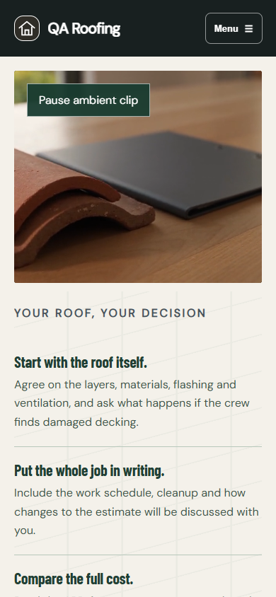
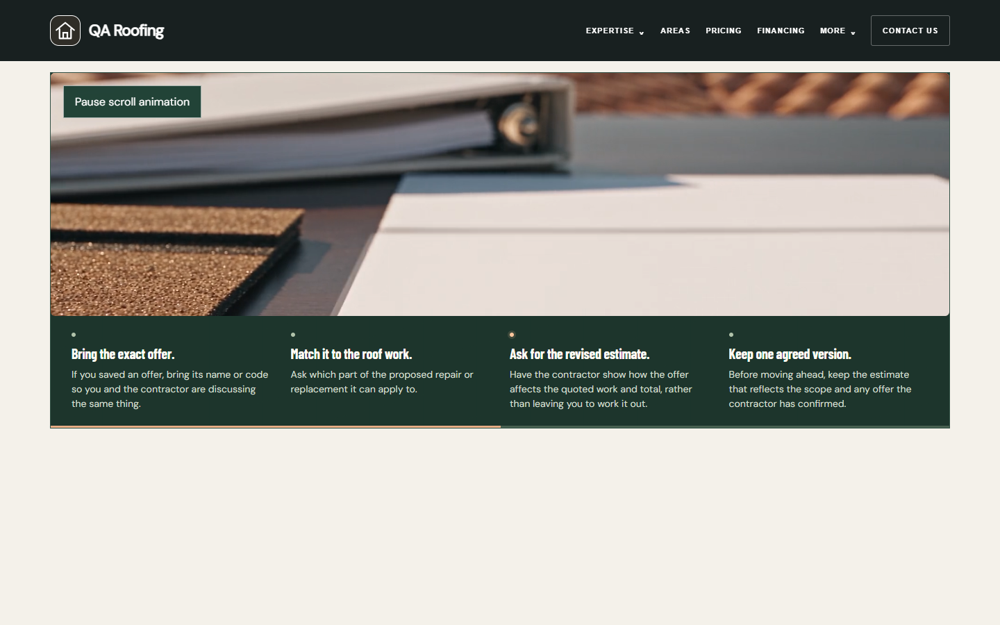
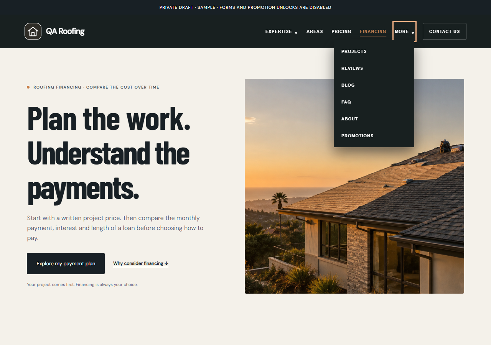

# #027A Part 1 — Roofing homeowner polish

Done locally on 2026-09-27. Branch: feature/local-environment-setup. No push, deploy or staging environment. Part 2 was not started.

**Higgsfield credits used: 0.** No generation, vendor call, expense row or account-balance request was made. This ticket only edits the already-paid #025 retake locally.

## Before and after

| Item | Before | Part 1 result |
|---|---|---|
| 1 — Captions | Template concept/stock/image captions and footer disclaimers repeated across kits. | Removed from source templates, runtime captions and film configs. Zero requested caption/disclaimer occurrences in 374 route responses plus 158 additional rendered variants. The small AI repair-example label directly beneath the comparison remains. Functional Before/After labels, contractor-authored project photo captions and private Sample badges keep their existing purpose. |
| 2 — Financing | Two planning films/stories and another numbered work/payment section repeated the same decision. | One chapter with four unnumbered points, the existing payment planner and eligibility gates, and a one-sentence next-step band. Existing CTA labels unchanged, including “Talk through my roof estimate”. New six-second local trim uses the existing ambient player. |
| 3 — Promotions | #027 used the same photo-left/list-right composition. | The unchanged #027 film sits above a horizontal four-step row; phone uses a compact two-column reading grid. Existing scroll sequencing, copy meaning, #026 chapter, and zero-offer behavior remain. |
| 4 — Copy | Repeated explanations and cautious introductory wording. | Direct homeowner language about the roof scope, written estimate, full cost and choosing at your own pace. No new offers, payment examples, urgency or promises. |
| 5 — FAQ | Brief generic defaults and repeated group labels. | Eight configured Roofing answers, each 40–70 words, covering warning signs, repair versus replacement, typical timing, cost drivers, preparation, care, financing and offers. Distinct group eyebrows include “Repair or replace” and “Cost and timing”. Authored questions and explicit empty states remain intact. |
| 6 — Header | Crowded desktop navigation and inconsistent anchor clearance. | Important links remain visible; More supports keyboard, Escape and outside click. JavaScript-off shows plain links. All 17 kits pass at 1280/1440; Financing and Promotions anchors clear the header on desktop and phone. The navigation mode is selected before first paint to prevent a layout shift. |
| 7 — Formatting | Raw phone digits, whole-dollar cents, ungrouped budgets and misaligned step markers. | Public phone displays use (805) 555-0111 formatting with existing normalized tel destinations. Whole money omits cents, budgets group thousands, and real fractional cents remain. Removed the phone financing-settings separator; aligned step markers. No extra negative 20px headline lift or empty homepage header band was present in the current source/render, so hero positioning and story assets were preserved. |
| 8 — Logo | The header always repeated the text business name beside the logo. | Contractor profile checkbox marks a logo that already contains the name. Marked logos hide duplicate visible text, retain an accessible name, preserve the mark when older editors omit it, and follow existing draft/Save/publish behavior. No extra Save button. |

## Reused work and scope

Reused #025 take 2 master, all original four catalog descriptors and assets, #024 ambient component and player, shared responsive video-source helper, #020-style scroll controller, #026 household chapter, #027 four scroll beats and paid clip, Phase 2 lazy/offscreen/pause/poster behavior, #017 lender/configured-term gates and calculator math, existing FAQ renderer and contractor config, shared header/footer, profile Save flow, service-page system, and existing QA fixture/check infrastructure.

The original #024 clip and encodes remain installed in the catalog, unused by the merged chapter. The rejected full #025 story remains Pending in its original catalog entry; its new clean six-second derivative is a separate Ready chapter entry. No asset was deleted or overwritten. The original Expenses data, ambient player and original media bytes are checked against base commit 16695fdfebb667038f92857fd5a44fe25afd43aa.

Older required illustrative labels and the queued headline raise conflict with the current request; the current removals take precedence. Older two-film Financing requirements are superseded by the single chapter. Remaining #027A items—including headline choice, service-tile redesign, review/source refresh work, ebook, manifest panel, hero editor, new comparison chart and next-step storyboards—remain Part 2. Hero/drone media and hero story order were preserved.

## Clip review and delivery

Source: original local master at docs/build-evidence/clips-phase2/025-take2/master.mp4, also recorded in the Phase 2 generation/master ledgers. Selected range: **0–6 seconds, 144 frames at 24 fps**. All 144 source frames were visually reviewed in the 12 contact sheets. No digits, text, calendar markings or planner printing appear. Blank folders and roofing samples remain center-safe in the phone crop. No roof work, faces or people are present in this range.

The final half-second dissolves to the first frame. Five finished-loop check frames are saved at 0%, 25%, 50%, 75% and 100%. All four encodes fully decode, have no audio stream, retain six-second duration and pass the Phase 2 eight-second size budgets. MP4 is H.264 with faststart; WebM is VP9. First/last-frame differences are documented in trim-review/loop-boundary.json and are limited to minor compression differences; the seam was also reviewed visually. The extracted first-frame poster is used because it exactly matches this new visual. Original posters remain untouched.

| File | Bytes | Decimal size |
|---|---:|---:|
| financing-1920.mp4 | 1,616,231 | 1.616 MB |
| financing-1920.webm | 512,403 | 0.512 MB |
| financing-960.mp4 | 344,403 | 0.344 MB |
| financing-960.webm | 175,174 | 0.175 MB |
| financing-poster-1280.webp | 30,114 | 0.030 MB |
| financing-poster-720.webp | 13,778 | 0.014 MB |

## Verification

- 98/98 check commands passed: 71 regression scripts, 23 browser suites, build, typecheck, asset integrity and the platform mobile suite.
- 624 new Part 1 regression assertions; 199 new browser assertions; 210 platform mobile states.
- 633 existing referenced assets validated; all six new video/poster files additionally hash-checked, with video codec/audio/duration/faststart/size/full-decode verification.
- 374 route responses across all 17 kits compared to pre-edit raw HTML; zero unauthorized residual differences. The global header means no response is raw-byte-identical; everything outside the explicitly permitted presentation edits and scoped Roofing sections is byte-identical after documented normalization. [Every changed page](changed-pages.md), [hashes and scope](changed-pages.json), raw before/after folders, and delta-residuals.json provide the proof.
- 158 additional rendered variants cover all 17 kits × three templates × three motion layouts, plus five legacy Roofing templates. Default concept-caption occurrences are zero. “Illustrative APR” remains only as an existing honest calculator field in other trades; it is not an image caption.
- JavaScript-off/reduced-motion retain decoded posters and full text; video requests remain zero. Lazy source assignment, manual pause, offscreen pause, error fallbacks, responsive encoding, 120ms transition and zero media layout shift passed existing player browser checks. Both completed Promotions clips and the new Financing chapter appear on published local fixtures.
- 43/43 QA URLs returned 200 after restarting Vite with the requested command. Fixtures use explicit local QA names and configured test terms to exercise the existing eligibility gate; they are not contractor offers or live lender responses.
- 7,041 prior evidence files restored/verified byte-for-byte; 688 unrelated/untracked files hash-verified unchanged. Prior test output was copied into this new folder before restoration.

The four historical Pending-media suites use the original Phase 1 catalog as a temporary test fixture (with the new chapter retained), then restore the installed catalog byte-for-byte and rebuild. This preserves their missing-media and publish coverage. The legacy calendar browser suite reuses its already-documented controlled clock; no product calendar code changed. Old caption expectations and frozen response contracts were updated only for the authorized Part 1 deltas. Full final command records are in final-checks.json, with initial attempts/retries retained.

## Visual evidence

31 screenshots in screenshots/: Home, Financing, Promotions, FAQ (including expanded answer), Oxnard city, mid-clip playback, reduced-motion and JavaScript-off at 1440×900 and 390×844; More open at 1280 and 1440; JavaScript-off plain navigation; HVAC Financing at its anchor on desktop and phone. Twelve contact sheets and five quarter-point frames are in trim-review/. Local loop master is retained there; installed web files are under public/assets/planning/027A-part1/.

